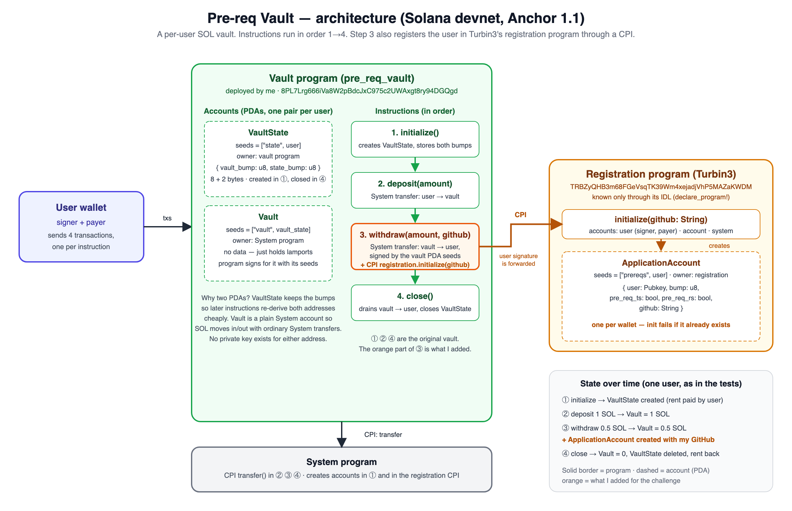

# Turbin3 Q4 2026 Builders Cohort — Prerequisite: Vault Program

Anchor vault program extended so that `withdraw` registers the user in Turbin3's
registration program through a Cross-Program Invocation (CPI).

| | |
|---|---|
| **Deployed program (devnet)** | [`8PL7Lrg666iVa8W2pBdcJxC975c2UWAxgt8ry94DGQgd`](https://explorer.solana.com/address/8PL7Lrg666iVa8W2pBdcJxC975c2UWAxgt8ry94DGQgd?cluster=devnet) |
| **Withdraw + registration tx** | [`32wdDugg…Cg7wqA`](https://explorer.solana.com/tx/32wdDuggZNH6QNNoG1N5m5zeT3Jdp8fKTZa1L8DxCMU4iSXqVMvVkBERsNWfQ6mc2eVWBGaQVoWckrmD6Cg7wqA?cluster=devnet) |
| **Application account created by the CPI** | [`2bAUuZhMWLAP2fZUnAvyV1nW8YMQWxdhdvwq6xmbrBm5`](https://explorer.solana.com/address/2bAUuZhMWLAP2fZUnAvyV1nW8YMQWxdhdvwq6xmbrBm5?cluster=devnet) |
| **Registration program (Turbin3)** | `TRBZyQHB3m68FGeVsqTK39Wm4xejadjVhP5MAZaKWDM` |
| **Architecture diagram** | [`docs/architecture.svg`](docs/architecture.svg) · [PNG](docs/architecture.png) |
| **Video (3 min)** | [youtu.be/shz_vM90OwE](https://youtu.be/shz_vM90OwE) |
| **Upstream repo** | [ShrinathNR/pre-req-vault](https://github.com/ShrinathNR/pre-req-vault) |

## Architecture



### Accounts

| Account | Seeds | Owner | Data | Purpose |
|---|---|---|---|---|
| `VaultState` | `["state", user]` | vault program | `vault_bump`, `state_bump` | Per-user config. Stores the bumps so every later instruction can re-derive both PDAs without a `find_program_address` loop. |
| `Vault` | `["vault", vault_state]` | System program | none | Holds the user's SOL. It is a plain system account, so SOL moves in and out through ordinary System `transfer`s; the program signs for it with the PDA seeds. |
| `ApplicationAccount` | `["prereqs", user]` **in the registration program** | registration program | `user`, `bump`, `pre_req_ts`, `pre_req_rs`, `github` | Created by the CPI in `withdraw`. One per wallet. |

### Instructions and state over time

| # | Instruction | What happens | Vault balance after |
|---|---|---|---|
| 1 | `initialize()` | Creates `VaultState` (user pays rent), stores both bumps. | 0 |
| 2 | `deposit(amount)` | CPI `System::transfer` user → vault. | +amount |
| 3 | `withdraw(amount, github)` | CPI `System::transfer` vault → user signed with the vault PDA seeds, **then CPI `registration::initialize(github)`**, which creates the `ApplicationAccount` and records the GitHub username. | −amount |
| 4 | `close()` | Drains the vault to the user and closes `VaultState` (rent back to user). | 0, accounts gone |

Trust boundary: the vault program never holds a private key. The only thing that can
move SOL out of the vault is an instruction signed by the user, executed by this program,
which signs for the PDA with `["vault", vault_state, bump]`.

## What I changed

1. **`withdraw` makes the registration CPI** (`programs/pre-req-vault/src/instructions/withdraw.rs`).
   After the SOL transfer, it builds the `Initialize` account struct generated by
   `declare_program!(registration)` from `idls/registration.json` and calls
   `registration::cpi::initialize(ctx, github)`. The `user` signer of the outer
   transaction is forwarded, so the registration program sees `user` as signer and payer
   for the new account. `application_account` is validated with `seeds::program =
   application_program.key()`, so the vault program only ever passes the correct PDA.
2. **The GitHub username is an instruction argument**, `withdraw(amount, github)`, instead of a
   constant compiled into the program. The deployed program carries no personal data, any
   wallet can use it, and the argument mirrors the registration program's own `initialize(github)`.
3. **Own deployment.** New program keypair (`anchor keys sync`), `declare_id!` and
   `Anchor.toml` updated, deployed to devnet with the IDL published on-chain. The team's
   deployed vault is never called.
4. **Tests** (`tests/pre-req-vault.ts`):
   - `withdraw` now passes the GitHub username and, after the transfer, **fetches the
     `ApplicationAccount` through the registration IDL and asserts `user` and `github`**,
     which is the success criterion of the challenge.
   - Fixed three missing `await`s on `confirmTx`, which let balances be read before the
     transaction was confirmed and made the assertions flaky.
5. **Tooling fixes** so the repo builds on current toolchains: `package_manager = "pnpm"` in
   `Anchor.toml`, and `allowBuilds` config for pnpm 11.

Transaction log of the withdraw, showing the CPI chain
(`my program → registration → System`):

```
Program 8PL7Lrg666iVa8W2pBdcJxC975c2UWAxgt8ry94DGQgd invoke [1]
Program log: Instruction: Withdraw
Program 11111111111111111111111111111111 invoke [2]
Program 11111111111111111111111111111111 success
Program TRBZyQHB3m68FGeVsqTK39Wm4xejadjVhP5MAZaKWDM invoke [2]
Program log: Instruction: Initialize
Program 11111111111111111111111111111111 invoke [3]
Program 11111111111111111111111111111111 success
Program TRBZyQHB3m68FGeVsqTK39Wm4xejadjVhP5MAZaKWDM success
Program 8PL7Lrg666iVa8W2pBdcJxC975c2UWAxgt8ry94DGQgd success
```

## Running it

Toolchain used: Rust 1.99, Solana CLI 4.3.0, **anchor-cli 1.1.2** (the crate pins
`anchor-lang = "1.1.2"`; anchor-cli 0.3x will not build it), Node 24, pnpm 11.

```bash
pnpm install
anchor keys sync                    # generates your own program keypair, updates declare_id! + Anchor.toml
anchor build -- --arch v0           # anchor-cli 1.1.2 pins platform-tools v1.52, which cannot target SBPF v3
anchor idl build -o target/idl/pre_req_vault.json -t target/types/pre_req_vault.ts
anchor deploy -- --max-len 200000   # ~1.4 SOL of rent on devnet; default max-len needs ~2.8 SOL peak
GITHUB_USERNAME=<your-github> anchor test --skip-build --skip-deploy --skip-local-validator
```

Notes:
- The registration program allows **one registration per wallet**. The test suite passes
  once per wallet; a second run fails at `withdraw` because the application account
  already exists. Use another wallet (`ANCHOR_WALLET=...`) to run it again.
- `anchor build` runs the IDL build through `cargo test`, which does not accept `--arch`,
  hence the separate `anchor idl build` step.

## Project layout

```
programs/pre-req-vault/src/
  lib.rs                      # entrypoints: initialize, deposit, withdraw, close
  state.rs                    # VaultState { vault_bump, state_bump }
  instructions/withdraw.rs    # transfer + CPI to the registration program (the change)
idls/registration.json        # IDL of Turbin3's registration program (declare_program!)
tests/pre-req-vault.ts        # devnet tests, verify the on-chain registration
docs/architecture.svg|png     # architecture diagram
```

## Author

Pedro Gattai · GitHub [@pedro-gattai](https://github.com/pedro-gattai)
